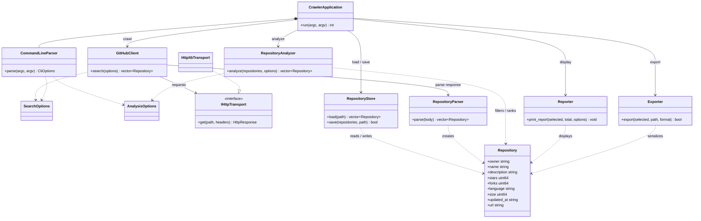

# GitHub Crawler — Milestone 3 System Design

## Overview

The GitHub Crawler has two workflows: it can search the GitHub REST API and save the returned repositories, or load a local JSON dataset, filter and rank its repositories, print a report, and export the selection. This report describes the observable requirements and a refactoring design that separates command handling, API access, persistence, analysis, and presentation. The design builds on the current C++20 implementation; the tests below are planned for the final milestone and are not claimed as newly implemented tests.

## 1. Requirements Analysis

| ID | Requirement |
|---|---|
| R1 | The program shall accept command-line options for crawl or analysis mode, show help, and reject unknown, incomplete, or invalid options. Crawl count shall be an integer from 1 through 100; analysis sort keys shall be `stars`, `forks`, or `updated`. |
| R2 | In crawl mode, the program shall issue a GitHub repository search using the requested query and count, and convert each valid API result into a repository containing its owner, name, description, stars, forks, language, size, update time, and URL. |
| R3 | Crawl mode shall display the fetched repositories and save them as a JSON array in `repositories.json`. A failed request, invalid API response, or failed save shall produce an error and a nonzero exit status. |
| R4 | In analysis mode, the program shall load a JSON array from the requested dataset path. It shall reject unreadable files, malformed JSON, and a non-array root; non-object array elements shall be skipped, and omitted repository fields shall use the existing empty-string or zero defaults. |
| R5 | Analysis shall retain repositories with stars greater than or equal to the minimum and, when specified, a case-insensitive language match. It shall sort descending by the selected key, using owner and then name ascending to break ties. |
| R6 | Analysis shall return no more than the requested top N repositories. A top-N value of zero shall return an empty selection; if fewer than N repositories match, all matches shall be returned. |
| R7 | The analysis workflow shall print a report containing the dataset, loaded count, active filters, sort key, requested top N, and selected repositories. It shall export the selection as JSON or CSV, choosing the format from the requested format or, when automatic, the file extension. |
| R8 | The program shall report analysis, loading, and export errors rather than treating a failed operation as a successful result. |

## 2. System Design

### Responsibilities and design decisions

The current program already has useful boundaries (`GitHubClient`, `RepositoryParser`, `DataLoader`, `Reporter`, and `Exporter`), but analysis and parts of persistence are free functions, and `main` coordinates both full workflows. The refactoring will retain the existing command-line behavior and move coordination into an application class. Small, single-purpose classes make network, file, analysis, and output behavior independently testable.

| Class | Responsibility, data, and main interface |
|---|---|
| `Repository` | Domain value type for one GitHub repository. Carries the nine metadata values in R2; it is passed between services without depending on JSON, HTTP, or console code. |
| `SearchOptions` | Value type for the search query and requested result count. Defaults match the current crawler defaults. |
| `AnalysisOptions` | Value type for dataset path, minimum stars, optional language, sort key, top N, export path, and format. |
| `IHttpTransport` / `HttplibTransport` | `IHttpTransport` defines an HTTP GET boundary; `HttplibTransport` implements it using cpp-httplib. This allows tests to supply a fake response without making live network calls. |
| `GitHubClient` | Builds the GitHub search request, applies request headers and an available token, and returns the response body or a clear request error. Holds an `IHttpTransport` reference. Main operation: `search(const SearchOptions&)`. |
| `RepositoryParser` | Converts a GitHub API response body into `std::vector<Repository>` and reports malformed or incomplete API data. Main operation: `parse(body)`. |
| `RepositoryStore` | Reads analysis datasets and saves crawled repositories in the existing JSON-array schema. Main operations: `load(path)` and `save(repositories, path)`. This consolidates the closely related loading and crawl-save responsibilities currently split across `DataLoader` and free functions in `repository_store`. |
| `RepositoryAnalyzer` | Applies the active filters, performs deterministic sorting, and limits the result to top N. Main operation: `analyze(repositories, options)`. It does not read files or print output. |
| `Reporter` | Formats and prints the analysis summary and selected repository rows. |
| `Exporter` | Writes selected repositories in JSON or CSV, including CSV escaping and format selection. Returns failure when the destination cannot be written. |
| `CommandLineParser` | Converts `argv` into the selected mode and `SearchOptions` or `AnalysisOptions`; validates values and separates help from errors. |
| `CrawlerApplication` | Coordinates the parsed mode and services, handles workflow-level errors and exit status, and keeps `main` as a small entry point. |

The repository and option types remain lightweight values. Service responsibilities are separated so, for example, the analyzer can be tested using in-memory repositories and the crawler can be tested with a fake transport. The injected transport avoids making the core workflow dependent on GitHub availability.

### Class relationships



### Representative C++ interfaces

These declarations illustrate the proposed boundaries; implementation details and supporting types are omitted.

```cpp
class IHttpTransport {
public:
    virtual ~IHttpTransport() = default;
    virtual HttpResponse get(std::string_view path,
                             const HttpHeaders& headers) const = 0;
};

class GitHubClient {
public:
    explicit GitHubClient(const IHttpTransport& transport);
    std::vector<Repository> search(const SearchOptions& options) const;

private:
    const IHttpTransport& transport_;
};

class RepositoryAnalyzer {
public:
    std::vector<Repository> analyze(
        const std::vector<Repository>& repositories,
        const AnalysisOptions& options) const;
};

class CrawlerApplication {
public:
    explicit CrawlerApplication(GitHubClient& github_client);
    int run(int argc, char* argv[]);

private:
    CommandLineParser command_line_parser_;
    GitHubClient& github_client_;
    RepositoryStore store_;
    RepositoryAnalyzer analyzer_;
    Reporter reporter_;
    Exporter exporter_;
};
```

### Class interactions

1. `main` creates the application and delegates the arguments to `CrawlerApplication`. `CommandLineParser` validates the arguments and supplies either crawl or analysis options. Help exits successfully; invalid options return an error status.
2. In crawl mode, `CrawlerApplication` passes `SearchOptions` to `GitHubClient`. The client builds the encoded GitHub search request and uses `IHttpTransport`; its response body is passed to `RepositoryParser`. If the request or parsing fails, the application reports the error and stops. Otherwise, `RepositoryStore` saves the resulting repositories to `repositories.json`, and the crawler output is displayed.
3. In analysis mode, `RepositoryStore` loads the dataset into repository values. `RepositoryAnalyzer` filters by minimum stars and optional language, sorts by the selected key and stable tie-breakers, then truncates to top N. `Reporter` displays the result and `Exporter` writes it to the requested file. Each failed load, analysis, or export is surfaced to the user and produces a nonzero status.

## 3. Test Design

Tests will use temporary files for storage and export cases, in-memory repository values for analysis, and a fake `IHttpTransport` for crawler cases. Network tests will not require a GitHub token or a live API.

| Test | Target | Input / setup | Expected result |
|---|---|---|---|
| T1 — CLI defaults and help | R1, `CommandLineParser` | Parse no options; separately parse `--help`. | Defaults select analysis mode and the documented default values; help is reported as a successful help request without starting a workflow. |
| T2 — CLI validation | R1, `CommandLineParser` | Try count values `0`, `101`, and nonnumeric text; an unsupported sort key; an unknown option; and a missing option value. | Each invalid argument set is rejected with a useful diagnostic; valid boundary counts `1` and `100` are accepted. |
| T3 — Crawl request and API mapping | R2, `GitHubClient`, `RepositoryParser` | Use a fake transport to return a valid API search response containing all repository fields, including null description and language. | The requested query and count are sent; one correctly mapped repository is returned, with null optional text represented as empty text. |
| T4 — Crawl failures | R2, R3, `GitHubClient`, `RepositoryParser` | Fake a network/HTTP error, malformed JSON, missing `items`, non-array `items`, and an item missing a required field. | Each failure is reported and does not produce a successful crawl result. |
| T5 — Crawl persistence | R3, `RepositoryStore` | Save representative crawler results to a temporary JSON path, then read the file. Also use a path whose parent does not exist. | The valid file is a JSON array with all repository fields and values; an unwritable path reports failure. |
| T6 — Dataset loading | R4, `RepositoryStore` | Load a valid array with complete and missing fields, an array containing a non-object element, and an empty array. | Complete values are preserved; missing fields use empty/zero defaults; non-objects are skipped; an empty array loads as empty. |
| T7 — Invalid dataset errors | R4, R8, `RepositoryStore` | Attempt to load a nonexistent path, malformed JSON, and a JSON object instead of an array. | Each input causes a clear loading error; no malformed dataset is treated as an empty successful dataset. |
| T8 — Filter boundaries | R5, `RepositoryAnalyzer` | Provide repositories below, equal to, and above the minimum star count; specify a language with different capitalization; repeat with no language filter. | The minimum is inclusive, language matching is case-insensitive, and an empty language filter allows every repository meeting the star threshold. |
| T9 — Sorting and ties | R5, `RepositoryAnalyzer` | Analyze records with different stars, forks, and update times, plus ties with distinct owners/names; try an invalid sort key. | Each supported key sorts descending and ties sort by owner then name ascending; an unsupported key is rejected. |
| T10 — Top-N edges | R6, `RepositoryAnalyzer` | Request top N as zero, less than the number of matches, equal to it, and greater than it. | Results contain respectively zero, N, all N, or all available matching records, without changing the source collection. |
| T11 — Report content | R7, `Reporter` | Capture output for a dataset with selected records and an empty language filter. | Output includes dataset path, loaded and selected counts, filters, sort, requested top N, and the selected repository details. |
| T12 — Export formats and errors | R7, R8, `Exporter` | Export multiple records and an empty selection as JSON and CSV; include comma, quote, and newline characters in CSV text; test extension-based selection, explicit format, and an unwritable path. | JSON is a valid array; CSV has the expected header and correctly escaped fields; empty exports have no data rows; format selection follows the requested rule; write failure is returned to the application. |
| T13 — End-to-end workflow coordination | R3, R7, R8, `CrawlerApplication` | Run analysis with a temporary dataset and export path; run crawl with a fake transport; then simulate a load or save failure. | Analysis reports and exports the selected data; crawl saves and reports mapped data; failures produce nonzero status and are not reported as successes. |

Together, T1–T2 verify command configuration, T3–T5 exercise the crawl pipeline and its I/O boundaries, T6–T10 cover dataset handling and analysis rules, and T11–T12 validate user-visible output and exports. T13 checks that the application connects the independently tested classes and propagates errors correctly.